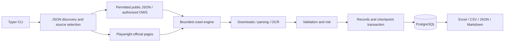

# Kazakhstan Procurement Parser

An async Python 3.12+ crawler for **real, official Kazakhstan public procurement
data**. It observes JSON traffic on the JavaScript portal, prefers a permitted
API, and falls back to Playwright. PostgreSQL stores original records, document
text, validation, risk explanations and transactional crawl checkpoints.

**Status:** implemented and tested locally, including a live end-to-end crawl
of one official lot, nine successfully parsed attachments, SQLite persistence
and a verified two-sheet Excel export. The specification retained approximately
192,000 characters without truncation. This is not production certification or a demonstrated
100,000-record benchmark. External integration limits are stated below.

## Official access constraints

Research date: **8 October 2026**. See [verified routes and evidence](docs/portal-research.md).

- [zakup.gov.kz](https://zakup.gov.kz/) renders through JavaScript. Its current
  [robots.txt](https://zakup.gov.kz/robots.txt) disallows direct `/api/` crawling.
  Automatic mode observes normal browser traffic but does not replay a forbidden
  endpoint. It uses the permitted [official legacy portal](https://old.goszakup.gov.kz/ru/search/lots),
  respecting its five-second crawl delay.
- Public search has a **10,000-result window**. A capped search raises an explicit
  incomplete-crawl error. It is never reported as a complete large dataset.
- Bulk ingestion uses [OWS v3 GraphQL](https://old.goszakup.gov.kz/ru/developer/ows_v3),
  with `after` keyset pagination and up to 200 records per page. The Electronic
  Finance Center must issue `OWS_TOKEN`; an anonymous crawler cannot acquire this
  authorization automatically.
- The portal exposes **ENSTRU, not CPV**. `--cpv` reports an unsupported filter;
  no mapping is invented. Classification text never replaces a specification.

## Docker quick start

Requires a running Docker Engine and Compose **2.24+**. No `.env` is needed for
the default local stack:

```sh
docker compose up --build
```

Compose starts PostgreSQL, waits for readiness, applies Alembic migrations, then
runs `crawl --export excel`. Named volumes persist data and logs; PostgreSQL is
not exposed on the host network. The image includes Chromium, Tesseract with
Russian/Kazakh/English packs, LibreOffice Writer and `unar`. Database credentials
in the default stack are local development defaults.

For a small first run and a resumable continuation:

```sh
docker compose up -d postgres
docker compose run --rm crawler crawl --limit 10 --export excel
docker compose run --rm crawler crawl --resume --limit 10 --export json
docker compose run --rm crawler doctor
```

Repeat identical filters/source when resuming:

```sh
docker compose run --rm crawler crawl --city Pavlodar --limit 50
docker compose run --rm crawler crawl --city Pavlodar --resume --limit 50 --export excel
```

Copy exports from a retained Compose container, or bind a directory for a one-off run:

```sh
docker compose cp crawler:/app/data/exports ./exports
docker compose run --rm -v "./exports:/app/data/exports" crawler crawl --limit 10 --export excel
```

## Native installation

Install Python 3.12+, PostgreSQL and uv. Run from the project root:

```sh
uv sync --frozen
uv run playwright install chromium
```

Copy `.env.example` to `.env` (`Copy-Item .env.example .env` in PowerShell), set
the PostgreSQL URL, then:

```sh
uv run python main.py init-db
uv run python main.py doctor
uv run python main.py crawl --limit 10 --export excel
```

Native OCR requires Tesseract and configured language packs on `PATH`. Legacy
DOC requires LibreOffice; compressed RAR requires `unar`/`unrar`. Missing binaries
produce explicit parsing errors and retain original files. Docker installs these
dependencies automatically. SQLite is used only for tests and local smoke checks.

## CLI examples

`uv run procurement-parser` and `uv run python main.py` expose the same CLI:

```sh
uv run procurement-parser crawl
uv run procurement-parser crawl --region Pavlodar
uv run procurement-parser crawl --keyword software
uv run procurement-parser crawl --status active
uv run procurement-parser crawl --city Pavlodar --export excel
uv run procurement-parser crawl --budget-min 0 --budget-max 500000
uv run procurement-parser crawl --date-from 2026-10-01 --date-to 2026-10-09
uv run procurement-parser crawl --method "Запрос ценовых предложений" --limit 5000
uv run procurement-parser crawl --customer OFFICIAL_BIN --supplier OFFICIAL_NAME
uv run procurement-parser crawl --announcement-number NUMBER --lot-number NUMBER
uv run procurement-parser crawl --resume --limit 5000
uv run procurement-parser crawl --source ows --limit 100000 --export json
uv run procurement-parser export --format csv --run-id RUN_UUID
uv run procurement-parser export --format markdown --run-id RUN_UUID --valid-only
uv run procurement-parser export --format json --run-id RUN_UUID --include-filtered
uv run procurement-parser discover
uv run procurement-parser doctor
```

`--limit` counts candidates in that invocation, including invalid, filtered and
duplicate observations. A pending-page snapshot is saved before work; reaching
the limit pauses the run. Without a limit, crawling continues until exhaustion
or an explicit source restriction. Completed runs are not resumed accidentally.

Verified server filters reduce traffic; other requested predicates are checked
against enriched official records. **Missing evidence cannot satisfy a filter.**
Supplier filters may return no matches on open lots without a stated supplier.
Date filters concern publication, not submission. Date-only bounds mean midnight
in `TIMEZONE`; specify ISO timestamps for precise boundaries. Region filtering
is broader than the strict Pavlodar city rule.

## Architecture



```text
app/
  config/                  typed environment settings
  models/                  Pydantic source and analysis contracts
  crawler/
    api/                   public JSON and OWS GraphQL
    browser/               Playwright and endpoint discovery
    pagination/            durable pending-page snapshots
    http.py                trusted requests, robots, pacing and retries
    documents.py           bounded downloads and immutable originals
    engine.py              transactional orchestration
  parser/
    html/ pdf/ docx/ xlsx/  source/document parsers
    documents.py           format detection and archive traversal
    specification.py       full text and explicit labelled requirements
  validator/               submission, source, location and filters
  risk/                    rules independent of budget
  database/                SQLAlchemy models and async pooling
  repository/              batch upserts and audit snapshots
  export/                  streaming Excel, CSV, JSON and Markdown
  utils/                   UTC time, URLs and structured logging
tests/fixtures/official/   reduced real source captures with provenance
migrations/                versioned Alembic migrations
docker/                    image and migration entrypoint
logs/                      rotating structured audit logs
main.py                    CLI entrypoint
```

Adapters, transport, document processing and repositories are injected. The
engine retains at most a page and a bounded work batch; exports use database
keyset reads and an OpenPyXL write-only workbook. Downloads have their own
concurrency bound; source caches are bounded. These properties support large
jobs without retaining every lot in memory, but do not bypass source limits.

## Integrity and validation

UUID/timestamp models include `Announcement`, `Lot`, `Customer`, `Supplier`,
`Document`, `Attachment`, `Specification`, `RiskAssessment`, `ExportHistory`,
plus run, relationship and duplicate-audit tables. A batch and its checkpoint
commit together. Failed writes preserve pending rows. Resume uses the last
committed state, including when the source page has since changed.

Validity requires an available official source, an explicitly active status and
`submission_start <= now < submission_deadline`. Cancelled/completed
announcements override active-looking lots. A status dictionary's `is_active`
flag is not evidence of open bidding. Invalid lots retain reasons. Duplicate
observations are separately marked invalid with `DUPLICATE`, preserving the
canonical record. Identity includes **announcement number and lot number**:
the same lot number can occur in different announcement revisions.

Pavlodar city requires verified official delivery/work/service text containing
**`г. Павлодар`**. Customer addresses, province names alone and guesses do not
qualify. Missing proof yields `LOCATION_NOT_VERIFIED`. Nonmatching examined lots
remain stored for audit; exports honor the saved filter result. `--valid-only`
additionally removes invalid matches; `--include-filtered` includes nonmatching
observations when an audit of rejected candidates is needed.

Malformed schemas/identities are ingestion errors that preserve the checkpoint,
distinct from business-invalid records. Missing values stay missing.

## Documents and specifications

- PDF: all pages; native text plus automatic OCR for scanned/image-dominant
  pages. Partial failures retain available text with `partial_errors`.
- DOCX: paragraphs and tables. DOC: isolated headless LibreOffice conversion.
- XLS/XLSX: all worksheets with bounded cell traversal. Stored values/formula
  text are preserved; downloaded spreadsheet code is not executed.
- ZIP/RAR: nested parsing with traversal/symlink protection and limits on
  expanded bytes, member count and depth. Errors remain visible per document.
- Original bytes are SHA-256-addressed immutable files. Text is retained before
  producing an extractive preview. Nested named specifications keep provenance.

Warranty, certificates, installation, payment and execution requirements come
from official fields or explicit labelled text. This conservative extraction is
not a general semantic contract parser. Unrecognized fields remain missing;
full original text survives. OCR does not guarantee perfect transcription.

Risk is LOW/MEDIUM/HIGH with reasons. Missing critical specifications, complex
work and short deadlines produce HIGH; installation/certification/configuration
requirements produce at least MEDIUM. LOW requires a recognized standard product,
parsed specification and no detected special requirements. **Budget is never
an input.** Risk is a rule-based triage result, not a professional guarantee.

## Exports

Excel has the requested **Procurements** and **Sources** worksheets, risk colors,
source URLs, document links, verification times, validation reasons and missing
data. CSV/Markdown include provenance; JSON preserves the complete record.

Excel's 32,767-character cell limit is handled explicitly: each workbook has a
**`.originals.jsonl` sidecar** with lossless complete records. Long cells point
to it. Formula injection is neutralized for spreadsheet text. Output files are
staged, published atomically and recorded with row count/SHA-256 in export history.

## Configuration

[`.env.example`](.env.example) contains every typed default and commented optional
setting; never commit `.env` or credentials. Arrays use JSON syntax.

| Group | Environment settings |
| --- | --- |
| Database | `DATABASE_URL`, `DATABASE_POOL_SIZE`, `DATABASE_BATCH_SIZE` |
| Sources | `PORTAL_URL`, `LEGACY_PORTAL_URL`, `OFFICIAL_HOSTS`, `SEARCH_URL`, `SOURCE_MODE` |
| APIs | `OWS_URL`, `OWS_TOKEN`, `PUBLIC_API_PATH`, `PUBLIC_SYSTEM_NAME`, `PUBLIC_RESULT_WINDOW` |
| Network | `REQUEST_TIMEOUT`, `RETRY_ATTEMPTS`, `RETRY_MAX_WAIT`, `CONCURRENCY`, `DOWNLOAD_CONCURRENCY`, `REQUESTS_PER_SECOND`, `PROXY` |
| Browser/policy | `BROWSER`, `BROWSER_HEADLESS`, `BROWSER_WAIT_MS`, `RESPECT_ROBOTS`, `USER_AGENT` |
| Files | `DOWNLOAD_FOLDER`, `EXPORT_FOLDER`, `LOG_FOLDER`, byte/archive/PDF/spreadsheet limits |
| OCR/Office | `OCR_LANGUAGES`, `OCR_DPI`, `OCR_TIMEOUT`, `TESSERACT_BINARY`, `LIBREOFFICE_BINARY`, OCR thresholds |
| Validation | `TIMEZONE`, `ACTIVE_STATUSES`, `INACTIVE_STATUS_FRAGMENTS`, `PAVLODAR_PATTERN` |
| Risk/size | `RISK_HIGH_TERMS`, `RISK_MEDIUM_TERMS`, `RISK_STANDARD_TERMS`, `STRICT_DEADLINE_DAYS`, `SUMMARY_CHARACTERS`, `API_ANNOUNCEMENT_CACHE_SIZE`, `PAGE_SIZE` |

Changing a robots setting does not grant authorization. Defaults enforce the
published policy; use legitimate OWS access for bulk collection.

## Verification

```sh
uv run pytest -q
uv run ruff check app tests scripts main.py docker
uv run ruff format --check app tests scripts main.py docker
docker compose config --quiet
```

Tests cover real source captures, pagination, partial-page resume, cancellation,
database rollback, duplicate audits, location/date boundaries, robots/redirects,
retry limits, document bounds, OCR selection, archives and export safety.
Constructed unit-test inputs are labelled and never used as live procurement data.
`TEST_DATABASE_URL` enables an isolated-schema PostgreSQL integration test.

The complete verification suite passed **213 tests**, with the PostgreSQL test
skipped because no server was configured. Ruff and Compose configuration checks
also passed. The live source export is in `data/exports/live-smoke/`; its adjacent
`.originals.jsonl` preserves the complete original specification and provenance.

The development host reported **Docker Desktop is unable to start**. Compose
configuration and migration SQL were checked, but the image/runtime and real
PostgreSQL transactions were not verified here. OWS live integration requires a
token. Actual Tesseract, LibreOffice, legacy XLS input and compressed RAR require
their external integration checks; corresponding failure paths are tested.
100,000-record throughput has not been benchmarked.

## Troubleshooting

| Symptom | Action |
| --- | --- |
| Docker cannot start | Repair/start Docker Engine; Compose configuration validation alone does not run containers. |
| Missing migration table / database unavailable | Start PostgreSQL, check its URL and run `init-db`. |
| API blocked by robots | Use automatic/browser mode or authorized OWS. Discovery is not permission to replay. |
| Search-window exception | Narrow filters or use OWS; export committed records by run UUID. |
| No resumable run | Repeat identical filters/source; a completed job starts a new run. |
| Browser missing | Run `playwright install chromium`; install OS dependencies or use Docker. |
| OCR/DOC/RAR unavailable | Run `doctor`; install the executable/language packs or use the image. |
| No location/supplier/date matches | Inspect missing evidence; the crawler does not guess. |
| Source schema error | Inspect source/logs, update the adapter, then resume. |
| Windows sandbox cannot find Python | The virtual environment's base Python may be outside the sandbox; use a normal terminal or an accessible interpreter. |

## Screenshot placeholders

- `[Screenshot placeholder: CLI statistics and run UUID]`
- `[Screenshot placeholder: Excel Procurements with risk colors]`
- `[Screenshot placeholder: Sources with validation and documents]`

These are documentation slots, not fabricated run evidence.
